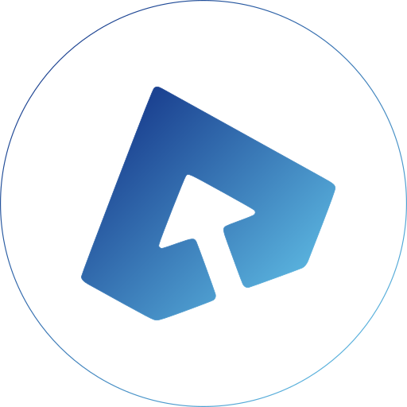
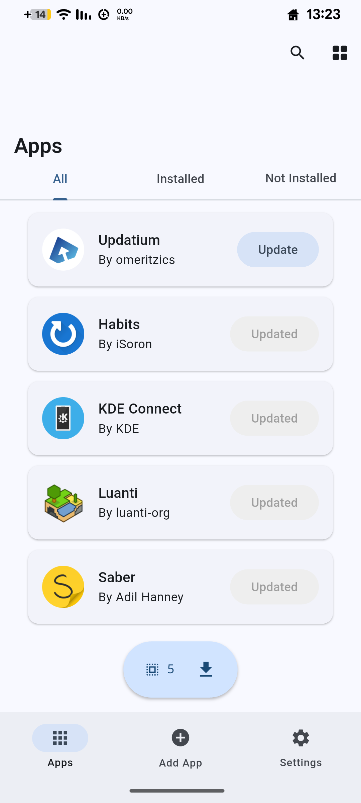
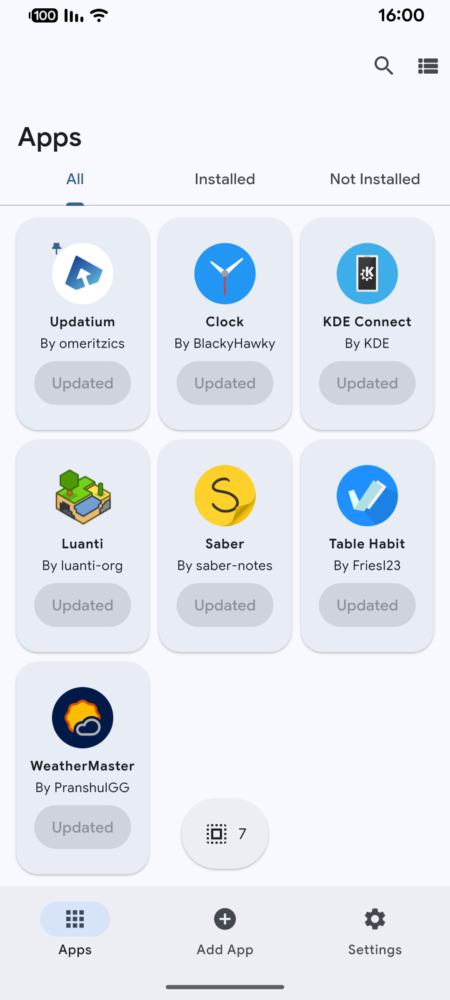
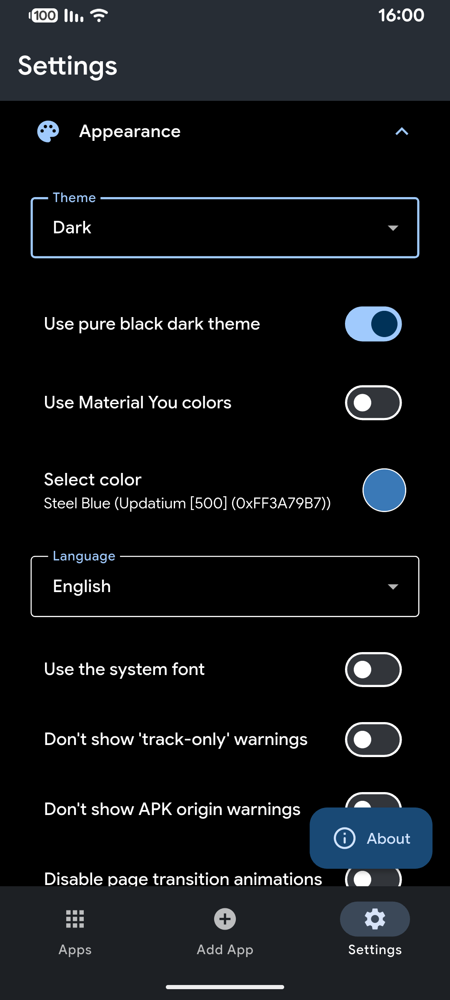
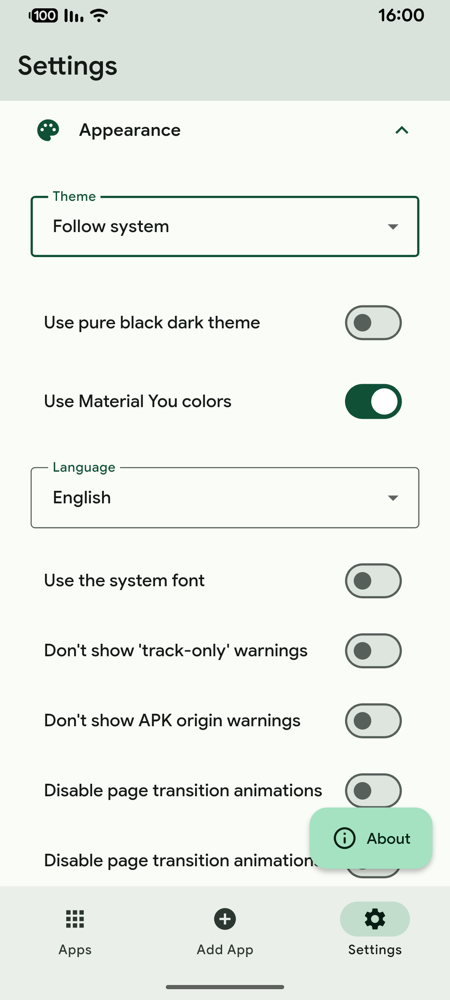
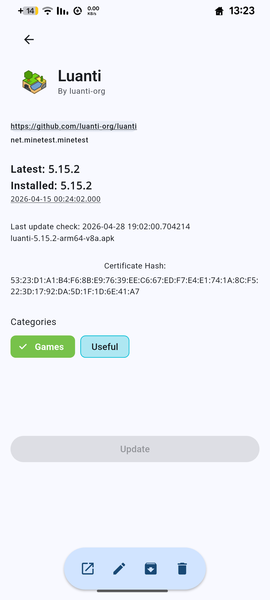
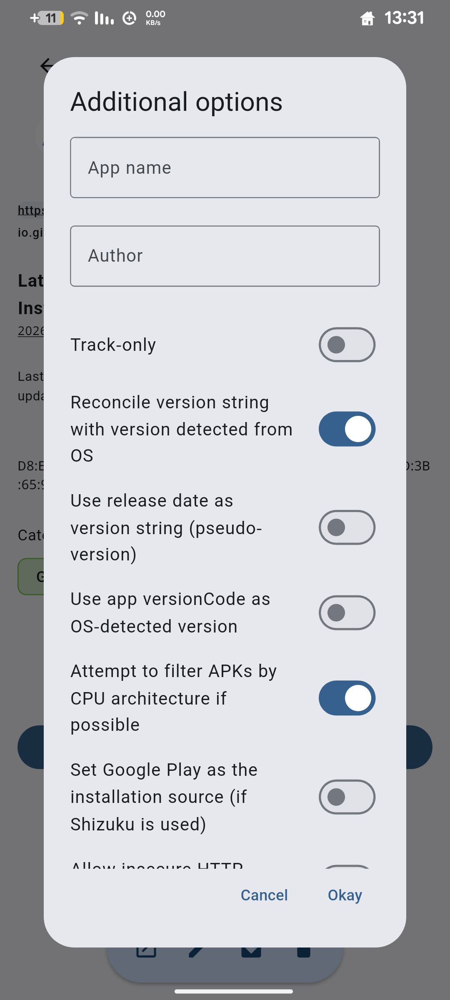
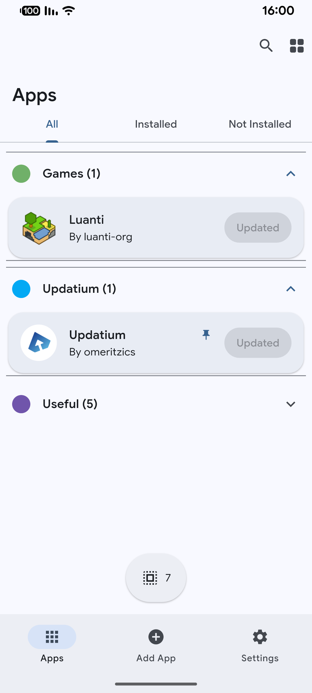
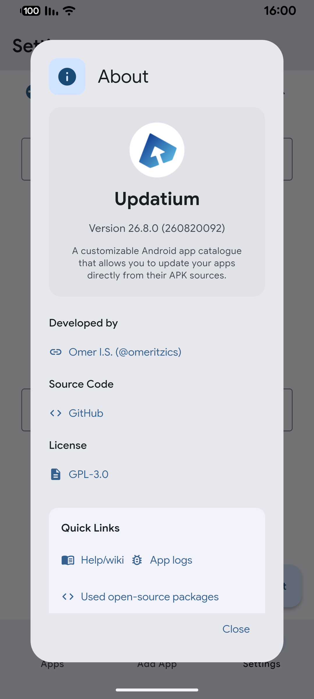

<!-- Created with GitHub Repo Banner by Waren Gonzaga: https://ghrb.waren.build -->

#  Updatium

Update your Android apps directly from the APK source. Updatium is a customizable Android app catalogue that allows you to update your apps directly from their APK sources, and to receive notifications when updates are available.

## Download

## Features

### Currently supported App sources

| Open Source (General) | Other (General) | Other (App-specific) |
| :------------------- | :-------------- | :------------------ |
|  [GitHub](https://github.com/) |  [APKPure](https://apkpure.net/) |  [Neutron Code](https://neutroncode.com/) |
|  [GitLab](https://gitlab.com/) |  [Aptoide](https://aptoide.com/) | 🏗️ Jenkins Jobs |
|  [Forgejo](https://forgejo.org/) ([Codeberg](https://codeberg.org/)) |  [Uptodown](https://uptodown.com/) | 📦 Direct APK Link |
|  [F-Droid](https://f-droid.org/) |  [Huawei AppGallery](https://appgallery.huawei.com/) | 🌐 HTML page fallback |
| 🧩 Third Party F-Droid Repos |  [Tencent App Store](https://sj.qq.com/) |  [WhatsApp](https://whatsapp.com/) |
|  [IzzyOnDroid](https://android.izzysoft.de/) |  [vivo App Store (CN)](https://h5.appstore.vivo.com.cn/) |  [Signal](https://signal.org/) |
|  [SourceHut](https://git.sr.ht/) |  [RuStore](https://rustore.ru/) |  [VLC](https://www.videolan.org/) |
|  [OpenAPK](https://www.openapk.net/) |  [APKCombo](https://apkcombo.com/) | |
|  [Bitbucket](https://www.bitbucket.org) |  [APKMirror (track-only)](https://apkmirror.com/) | |
|  [Gitea](https://try.gitea.io/) | | |

### Improved Design

Based on Material Design 3 Expressive guidelines.

### Other Additional Features

- Grid View.
- Ability to use DNS-over-HTTPS providers.
- Searching APKPure apps directly from the app.
- Better accessibility for screen readers.
- Safe Mode (allows you to block unwanted changes to the app catalogue).
<!-- - Editing basic app information after adding it (Nightly builds only). -->

### Localization

Updatium currently supports ~42~ 40 locales (including English). If you want to help translate Updatium to your language, you can help improving Updatium's translations [here (using Weblate)](https://hosted.weblate.org/engage/updatium). Every language is welcome to Updatium, but your help is needed to make it happen.

If you need any help or advice for translating Updatium to your language, or if you found any error in the translation strings, please open an issue  and I'd be happy to help.

- Currently supported locales:

`Taiwanese Hokkien (臺灣話) and Northen Kurdish (Kurdî) are not supported yet due to technical limitations.`

Warning: GitHub is currently the only official place to download Updatium. Beware of unofficial sources (such as Appteka) that distribute modified APKs, which may contain more bugs, or even malware.

If you want to distribute legitimate APK files of Updatium in your app store, please contact me by creating a new issue so I can add your store as an official publisher of Updatium.

## Screenshots

| |  |  |  |
|---|---|---|---|
|  |  |  |  |

## Frequently Asked Questions

### Q: What is Updatium?

A: Updatium started as a fork of [Obtainium](https://github.com/ImranR98/Obtainium), aiming to create a better replacement to it. Updatium is a customizable app catalogue, to which you can add almost any application you want from a variety of sources, like GitHub and APKPure.

### Q: Why fork Obtainium?

A: One word - antisemitism. While Obtainium is a really powerful tool, its developer's problematic political views take part in the way he treats his users.

Obtainium's developer intended to block people from a specific nation from getting involved in his project, and he actively closes new localization pull requests of Hebrew speakers.

Updatium aims not just to be an update to Obtainium, but also to provide a broad, accepting, welcoming open source community.

### Q: How is Updatium different from other Obtainium forks?

A: Every fork of Obtainium serves a different goal. For example, [Discoverium](https://github.com/cygnusx-1-org/Discoverium) is a catalogue for discovering new apps, while Updatium focuses on providing a better experience managing your already added apps.
While [ObtainX](https://github.com/bikram-agarwal/ObtainX) shares many vision aspects with Updatium, this project focuses on being simple and intuitive for both novice and tech-savvy people.
Also, Updatium is intended to be a customizable app catalogue that everyone can adjust to their needs.

### Q: Does Updatium encourage piracy?

A: Absolutely not! Updatium is highly against piracy and modded applications.

### Q: How do I migrate from Obtainium?

A: It's easy to update to Updatium from Obtainium, by following these steps:

On Obtainium:

1. Tap on Settings → Pick export directory.
2. Choose a directory path and confirm.
3. Tap on "Obtainium export" and confirm.

On Updatium:

1. Tap on Add App → Import/Export → Updatium import.
2. Locate Obtainium export file, tap on it, and confirm. Welcome to Updatium :)

### Q: How can I help?

A: There are many ways you can. It could be testing, bug reporting, adding new translations (or improving the existing ones), design and UX proposals, sharing ideas, or adding new features and improvements. Starring Updatium and sharing it to people who you think may like it will also help Updatium grow.

Your contribution doesn't have to be code, even though code contributions are welcome too. LLM generated code is acceptable, as long as the user (or another LLM) reviews the code carefully before submitting it.

To start, you can simply open a new thread on the [Discussions page](https://github.com/omeritzics/Updatium/discussions) and introduce yourself. Every contribution is welcome, and thank you for your support :)